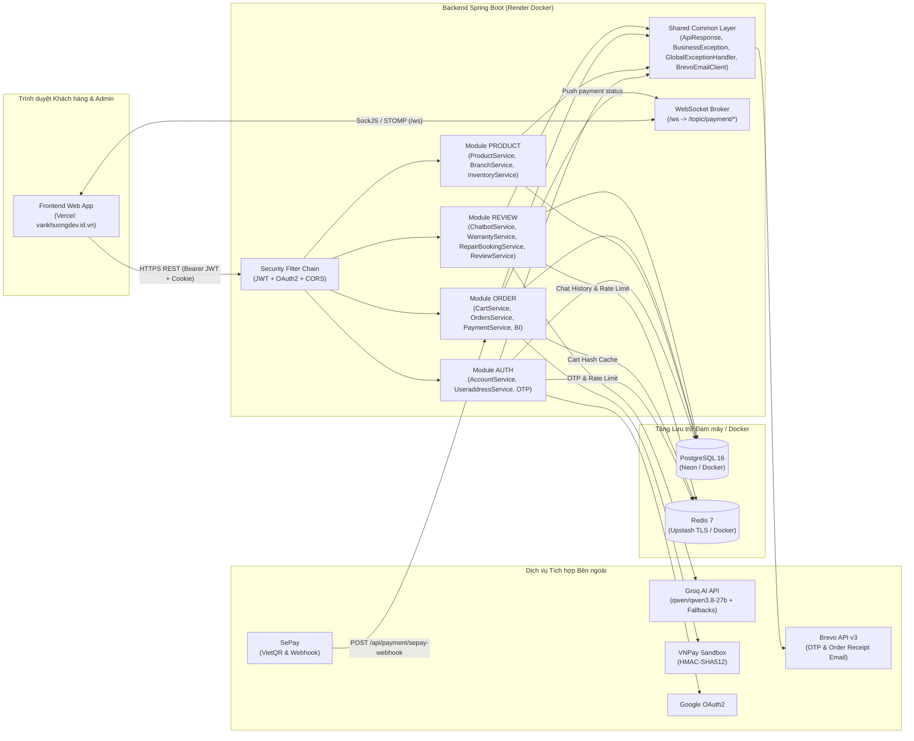

# 01. Kiến Trúc Tổng Thể Hệ Thống — HK COMPUTER

## 1. Sơ đồ kiến trúc triển khai (Deployment & Integration Architecture)



---

## 2. Kiến trúc phần mềm Backend (Modular Monolith — Chuẩn Quy Ước & Ranh Giới Module)

Mã nguồn trong `src/main/java/com/example/MyProject` được tổ chức theo mô hình **Modular Monolith** (không tách microservices khi chưa cần thiết) với 3 nguyên tắc kiến trúc được kiểm chứng tự động qua `ModuleBoundaryArchitectureTest`:

1. **Tách lớp 3 tầng nghiêm ngặt (`Controller -> Service -> Repository`):** Mọi Controller là Thin HTTP Adapter, không truy cập trực tiếp `Repository`.
2. **Quy ước đặt tên nhất quán 100%:** Toàn bộ interface nghiệp vụ nằm tại `<MODULE>/service/<Name>Service.java` và lớp triển khai nằm tại `<MODULE>/service/impl/<Name>ServiceImpl.java`.
3. **Ranh giới phân hệ qua Service Contract (Không truy cập chéo Repository):** Không một lớp nào trong `AUTH`, `PRODUCT`, `ORDER`, `REVIEW` được phép `import` gói `.repository.*` của phân hệ khác. Khi cần dữ liệu/nghiệp vụ liên phân hệ:
   - `ORDER` (`OrdersServiceImpl`, `CartServiceImpl`) gọi qua các hợp đồng nghiệp vụ công khai `UseraddressService` (`AUTH`), `ProductService`, `BranchService` và `InventoryService` (`PRODUCT`).
   - `REVIEW` (`ChatbotCatalogMatcher`, `WarrantyServiceImpl`, `RepairBookingServiceImpl`, `ReviewServiceImpl`) gọi qua `ProductService`, `InventoryService`, `BranchService` (`PRODUCT`) và `OrdersService` (`ORDER`).
   - `AdminDashboardServiceImpl` tổng hợp số liệu qua `AccountService`, `ProductService`, `InventoryService`, `BranchService`, `WarrantyService`, `RepairBookingService`.

```text
com.example.MyProject
├── MyProjectApplication.java       # Điểm khởi chạy gọn nhẹ (@EnableScheduling, @EnableAsync)
├── config/
│   └── DemoDataSeeder.java         # Khởi tạo dữ liệu mẫu idempotent (@ConditionalOnProperty("app.seed.enabled"))
├── common/                         # Tầng tiện ích & chuẩn hóa phản hồi dùng chung toàn hệ thống
│   ├── ApiResponse.java            # Chuẩn JSON thống nhất: { code, message, result }
│   ├── BaseController.java         # Lớp cha cung cấp ok(...) cho toàn bộ Controller
│   ├── BrevoEmailClient.java       # HTTP Client JDK 21 dùng chung gửi email OTP & biên nhận đơn hàng
│   ├── PhoneValidator.java         # Kiểm tra SĐT chuẩn 10 số Việt Nam (^0\d{9}$)
│   ├── ProcessPageable.java        # Chuẩn hóa phân trang 1-based an toàn
│   └── exception/
│       ├── BusinessException.java  # Ngoại lệ nghiệp vụ tường minh (trả HTTP 400)
│       └── GlobalExceptionHandler  # Phân tách: 400 Business/Validation, 401 Auth, 403 Forbidden, 500 System Error (log.error)
├── AUTH/
│   ├── controller/                 # AccountController, UseradressController
│   ├── security/                   # SecurityConfig, JwtService, JwtAuthenticationFilter, OAuth2, EmailVerificationService
│   └── service/ & impl/            # AccountService/AccountServiceImpl, UseraddressService/UseraddressServiceImpl,
│                                   # RedisOtpService/RedisOtpServiceImpl, RedisRateLimiterService
├── PRODUCT/
│   ├── config/                     # WebSocketConfig (/ws, broker /topic)
│   ├── controller/                 # ProductController, CategoriesController, BrandsController, BranchController, InventoryController
│   └── service/ & impl/            # ProductService/ProductServiceImpl, BranchService/BranchServiceImpl,
│                                   # InventoryService/InventoryServiceImpl, BrandsServiceImpl, CategoriesServiceImpl
├── ORDER/
│   ├── config/                     # SePayConfig, VNPayConfig
│   ├── controller/                 # CartController, OrderController, PaymentController, AdminDashboardController
│   └── service/ & impl/            # CartService/CartServiceImpl, RedisCartService/RedisCartServiceImpl,
│                                   # OrdersService/OrdersServiceImpl, PaymentService/PaymentServiceImpl,
│                                   # AdminDashboardService/AdminDashboardServiceImpl, OrderExpirationScheduler, OrderNotificationService
└── REVIEW/
    ├── config/                     # RestClientConfig (JDK 21 HttpClient timeout 5s/15s)
    ├── controller/                 # ChatController, WarrantyController, RepairBookingController, ReviewController
    └── service/ & impl/            # ChatbotService/ChatbotServiceImpl, ChatbotCatalogMatcher, ChatbotGuardrail,
                                    # WarrantyService/WarrantyServiceImpl, RepairBookingService/RepairBookingServiceImpl,
                                    # ReviewService/ReviewServiceImpl
```

---

## 3. Phân loại Ngoại lệ, Bảo mật & Đồng bộ Nguồn Chi nhánh

1. **Phân loại ngoại lệ rõ ràng (`GlobalExceptionHandler`):**
   - `BusinessException`, `IllegalArgumentException`, `MethodArgumentNotValidException` -> **`HTTP 400 Bad Request`** (`code = 999`, thông báo nghiệp vụ rõ ràng cho người dùng, ghi log ở mức `DEBUG`).
   - `AuthenticationException` (bao gồm cả Refresh Token hết hạn/thu hồi) -> **`HTTP 401 Unauthorized`** (`code = 401`).
   - `AccessDeniedException`, `SecurityException` -> **`HTTP 403 Forbidden`** (`code = 403`).
   - Mọi `Exception` / `RuntimeException` hạ tầng không dự kiến -> **`HTTP 500 Internal Server Error`** (`code = 500`, ghi `log.error` kèm stack trace đầy đủ cho vận hành, đồng thời trả thông báo an toàn không làm lộ chi tiết nội bộ).
2. **Thống nhất nguồn dữ liệu 3 chi nhánh & quy ước Fallback với Frontend:**
   - Nguồn dữ liệu chính thức duy nhất là bảng `branches` trên PostgreSQL thông qua API `GET /api/branches` (`HN-THAIHA` Hà Nội, `HCM-QUAN10` TP.HCM, `DN-HAICHAU` Đà Nẵng).
   - Trên `FE_Computer`, `branch-store.js` luôn nạp và đồng bộ từ `GET /api/branches` (`CONFIG.BRANCH_SOURCE = 'API'`). Hằng số `FALLBACK_BRANCHES` trong `config.js` (khớp đúng 3 cơ sở trên) chỉ đóng vai trò dữ liệu dựng khung ban đầu trước khi API phản hồi hoặc khi máy chủ tạm thời mất kết nối mạng.

---

## 4. Kênh Thời gian thực (WebSocket STOMP)

- **Endpoint kết nối:** `/ws` (hỗ trợ SockJS fallback, giới hạn `AllowedOrigins` tới `localhost:5500`, `vankhuongdev.id.vn`, `www.vankhuongdev.id.vn`).
- **Kênh phát sóng (`SimpleBroker`):**
  - `/topic/payment/{orderId}`: Đẩy `PaymentResponse` ngay khi SePay Webhook xác nhận giao dịch chuyển khoản, giúp màn hình QR tự đóng và báo thành công tức thì.

---

## 5. Tổng hợp các nhóm REST API chính

| Phân hệ | Tiền tố Đường dẫn | Các Endpoint tiêu biểu |
| :--- | :--- | :--- |
| **Tài khoản & Auth** | `/api/account` | `POST /register`, `POST /send-code`, `POST /check-code`, `POST /login`, `POST /refresh-token`, `POST /logout`, `PUT /forgot-password` |
| **Sổ địa chỉ cá nhân** | `/api/useraddresses` | `GET /user`, `POST /create`, `PUT /{id}/update`, `DELETE /{id}/delete` |
| **Chi nhánh** | `/api/branches` | `GET /` (active), `GET /admin/all`, `POST /create`, `PUT /{id}/update`, `DELETE /{id}/delete` |
| **Sản phẩm & Danh mục** | `/api/products`, `/api/categories`, `/api/brands` | `GET /api/products/catalog`, `GET /api/products/slug/{slug}`, `GET /api/products/{id}/detailproduct`, CRUD Admin |
| **Tồn kho Đa cơ sở** | `/api/inventory` | `GET /{id_product}/user`, `GET /{id_product}/branches`, `POST /create`, `PUT /{id}/soluong`, `PUT /{id}/adjust`, `POST /transfer` |
| **Giỏ hàng** | `/api/cart` | `GET /my-cart`, `POST /add`, `PUT /{productId}/update`, `DELETE /{id}` |
| **Đơn hàng & BI Admin** | `/api/orders`, `/api/admin/dashboard` | `POST /create`, `GET /my-orders`, `PUT /{id}/cancel`, `PUT /{id}/update-status`, `GET /api/admin/dashboard/summary` |
| **Thanh toán** | `/api/payment` | `GET /create-sepay/{order_id}`, `POST /sepay-webhook`, `GET /create-vnpay/{order_id}`, `POST /verify`, `GET /order/{order_id}/latest` |
| **AI Chatbot** | `/api/chat` | `POST /api/chat` (`{ "message": "...", "sessionId": "..." }`) |
| **Bảo hành & Sửa chữa** | `/api/warranty`, `/api/repairs` | `GET /lookup`, `GET /my-cards`, `POST /claims`, `POST /api/repairs`, `PATCH /admin/{id}/status` |
| **Đánh giá sản phẩm** | `/api/reviews` | `GET /product/{product_id}`, `POST /api/reviews` |
