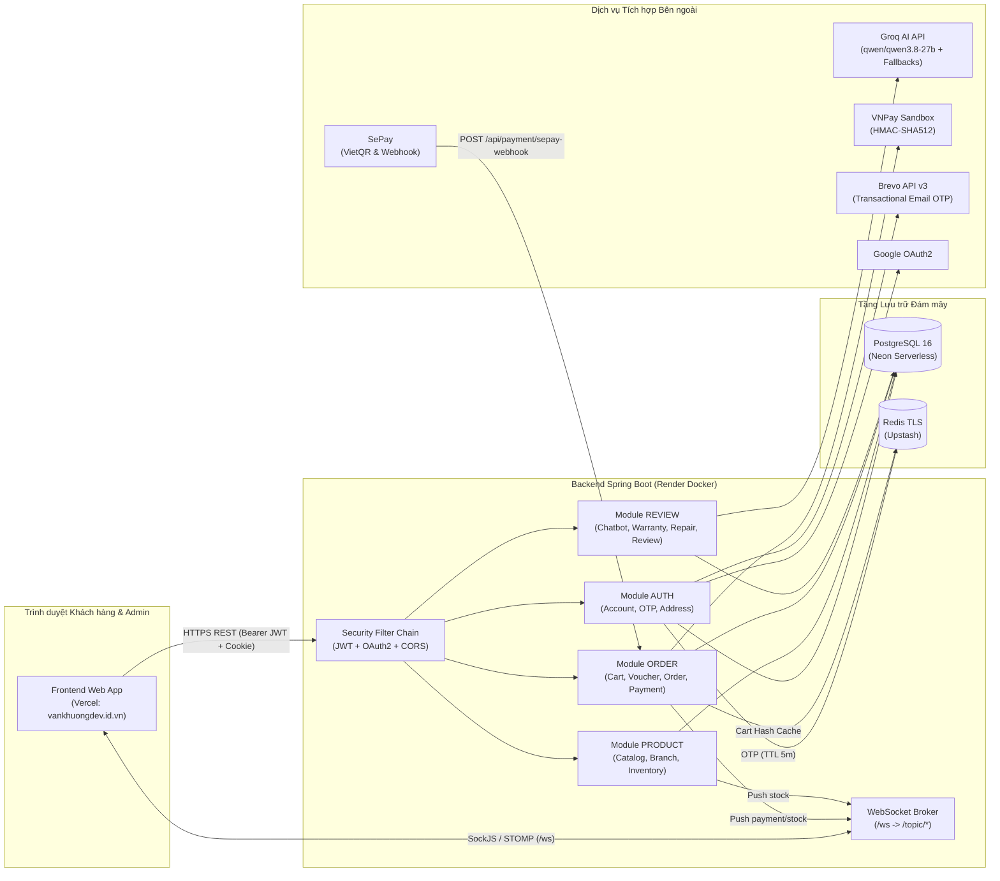

# 01. Kiến Trúc Tổng Thể Hệ Thống — HK COMPUTER

## 1. Sơ đồ kiến trúc triển khai (Deployment & Integration Architecture)



---

## 2. Kiến trúc phần mềm Backend (Modular Monolith — Chuẩn Tách Lớp 3 Tầng)

Mã nguồn trong `src/main/java/com/example/MyProject` được tổ chức theo mô hình **Modular Monolith** chia làm 4 phân hệ nghiệp vụ độc lập. **Mọi Controller trong hệ thống đều là Thin HTTP Adapter** (chỉ nhận request, kiểm tra `@PreAuthorize`, gắn cookie/response và ủy quyền hoàn toàn nghiệp vụ xuống tầng `Service`), tuyệt đối không gọi trực tiếp `Repository` hay đặt `@Transactional` ở tầng Controller:

```text
com.example.MyProject
├── MyProjectApplication.java       # Điểm khởi chạy (@EnableScheduling, @EnableAsync) & seed dữ liệu mẫu idempotent
├── AUTH/                           # Phân hệ Tài khoản, Xác thực & Sổ địa chỉ
│   ├── common/                     # ApiResponse, BaseController, PhoneValidator (chuẩn SĐT 10 số VN)
│   ├── config/                     # RedisConfig
│   ├── controller/                 # AccountController, UseradressController
│   ├── security/                   # SecurityConfig, JwtService, JwtAuthenticationFilter, OAuth2, EmailVerificationService
│   ├── service/ & impl/            # AccountService/IAccountService, UseraddressService/IUseraddressService,
│   │                               # RedisRateLimiterService, IRedisOtpService
│   └── exception/                  # GlobalExceptionHandler, CustomAuthenticationEntryPoint, CustomAccessDeniedHandler
├── PRODUCT/                        # Phân hệ Danh mục, Thương hiệu, Sản phẩm & Kho 3 Chi Nhánh Trọng Điểm
│   ├── config/                     # WebSocketConfig (/ws, broker /topic)
│   ├── controller/                 # ProductController, CategoriesController, BrandsController, BranchController, InventoryController
│   └── service/ & impl/            # ProductService/IProductService (hỗ trợ cả ID & slug), BranchService/IBranchService,
│                                   # InventoryService/IInventoryService, InventoryWebSocketService
├── ORDER/                          # Phân hệ Giỏ hàng, Đơn hàng, Thanh toán (SePay + VNPay) & Admin BI Dashboard
│   ├── config/                     # SePayConfig, VNPayConfig
│   ├── controller/                 # CartController, OrderController, PaymentController, AdminDashboardController
│   └── service/ & impl/            # CartService/ICartService, RedisCartService, OrdersService/IOrdersService,
│                                   # PaymentService/IPaymentService, AdminDashboardService/IAdminDashboardService,
│                                   # OrderExpirationScheduler, OrderNotificationService
└── REVIEW/                         # Phân hệ AI Chatbot, Bảo hành điện tử, Sửa chữa, Đánh giá & Hỗ trợ
    ├── config/                     # RestClientConfig (Netty timeout 5s/15s)
    ├── controller/                 # ChatController, WarrantyController, RepairBookingController, ReviewController, SupportController
    └── service/ & ipml/            # ChatbotService/IChatbootService, ChatbotGuardrail, IWarrantyService, IRepairBookingService, IReviewService, ISupportService
```

---

## 3. Cơ chế Bảo mật & Phân quyền

1. **Xác thực kép (Dual-Token Strategy):**
   - **Access Token (JWT):** Thời hạn ngắn (`15 phút`), ký bằng `HMAC-SHA256`, lưu trên `sessionStorage` của trình duyệt và đính kèm qua header `Authorization: Bearer <token>`.
   - **Refresh Token (Opaque UUID):** Thời hạn `7 ngày`, lưu trong bảng `refresh_tokens` và gửi qua cookie `HttpOnly; Secure; SameSite=None; Path=/` để chống đánh cắp qua XSS. Khi nhận `HTTP 401`, `FE_Computer/assets/js/api.js` tự động xếp hàng các request đang chờ, gọi `/api/account/refresh-token` lấy JWT mới và phát lại toàn bộ request mà người dùng không bị gián đoạn.
2. **Phân quyền RBAC (`@PreAuthorize`):**
   - `Public (permitAll)`: Xem danh mục, sản phẩm, chi nhánh, tồn kho, voucher khả dụng, đánh giá sản phẩm, tra cứu bảo hành công khai, đặt lịch sửa chữa vãng lai, chat với AI, nhận SePay Webhook.
   - `USER`: Quản lý sổ địa chỉ (kiểm tra đúng chủ sở hữu chống IDOR), giỏ hàng, đặt/hủy đơn hàng, thanh toán QR/VNPay, gửi yêu cầu bảo hành/đánh giá/hỗ trợ.
   - `ADMIN`: Toàn quyền quản trị sản phẩm, thương hiệu, danh mục, chi nhánh, nhập/điều chỉnh/luân chuyển kho giữa các cơ sở, quản lý voucher, duyệt đơn hàng, xử lý bảo hành và lịch hẹn sửa chữa.
3. **Chuẩn hóa dữ liệu đầu vào:**
   - Số điện thoại trên toàn bộ các biểu mẫu (Sổ địa chỉ, Đặt lịch sửa chữa, Yêu cầu bảo hành) đều đi qua `PhoneValidator` (`^0\d{9}$`).

---

## 4. Kênh Thời gian thực (WebSocket STOMP)

- **Endpoint kết nối:** `/ws` (hỗ trợ SockJS fallback, giới hạn `AllowedOrigins` tới `localhost:5500`, `vankhuongdev.id.vn`, `www.vankhuongdev.id.vn`).
- **Các kênh phát sóng (`SimpleBroker`):**
  - `/topic/payment/{orderId}`: Đẩy `PaymentResponse` ngay khi SePay Webhook xác nhận giao dịch chuyển khoản, giúp màn hình QR tự đóng và báo thành công tức thì.
  - `/topic/inventory/{inventoryId}`: Đẩy tổng tồn kho mới nhất ngay khi có khách đặt đơn, hủy đơn hoặc Admin nhập/điều chuyển kho.

---

## 5. Tổng hợp các nhóm REST API chính

| Phân hệ | Tiền tố Đường dẫn | Các Endpoint tiêu biểu |
| :--- | :--- | :--- |
| **Tài khoản & Auth** | `/api/account` | `POST /register`, `POST /send-code`, `POST /check-code`, `POST /login`, `POST /refresh-token`, `POST /logout`, `PUT /forgot-password` |
| **Sổ địa chỉ** | `/api/useraddresses` | `GET /user`, `POST /create`, `PUT /{id}/update`, `DELETE /{id}/delete` |
| **Chi nhánh** | `/api/branches` | `GET /` (active), `GET /admin/all`, `POST /create`, `PUT /{id}/update`, `DELETE /{id}/delete` |
| **Sản phẩm & Danh mục** | `/api/products`, `/api/categories`, `/api/brands` | `GET /api/products/catalog`, `GET /api/products/slug/{slug}`, `GET /api/products/{id}/detailproduct`, CRUD Admin |
| **Tồn kho Đa cơ sở** | `/api/inventory` | `GET /{id_product}/user`, `GET /{id_product}/branches`, `POST /create`, `PUT /{id}/soluong`, `PUT /{id}/adjust`, `POST /transfer` |
| **Giỏ hàng** | `/api/cart` | `GET /my-cart`, `POST /add`, `PUT /{productId}/update`, `DELETE /{id}` |
| **Đơn hàng & BI Admin** | `/api/orders`, `/api/admin/dashboard` | `POST /create`, `GET /my-orders`, `PUT /{id}/cancel`, `PUT /{id}/update-status`, `GET /api/admin/dashboard/summary` |
| **Thanh toán** | `/api/payment` | `GET /create-sepay/{order_id}`, `POST /sepay-webhook`, `GET /create-vnpay/{order_id}`, `POST /verify`, `GET /order/{order_id}/latest` |
| **AI Chatbot** | `/api/chat` | `POST /api/chat` (`{ "message": "..." }`) |
| **Bảo hành & Sửa chữa** | `/api/warranty`, `/api/repairs` | `GET /lookup`, `GET /my-cards`, `POST /claims`, `POST /api/repairs`, `PATCH /admin/{id}/status` |
| **Đánh giá & Hỗ trợ** | `/api/reviews`, `/api/support` | `GET /product/{product_id}`, `POST /api/reviews`, `POST /api/support`, `PATCH /admin/{id}/status` |
