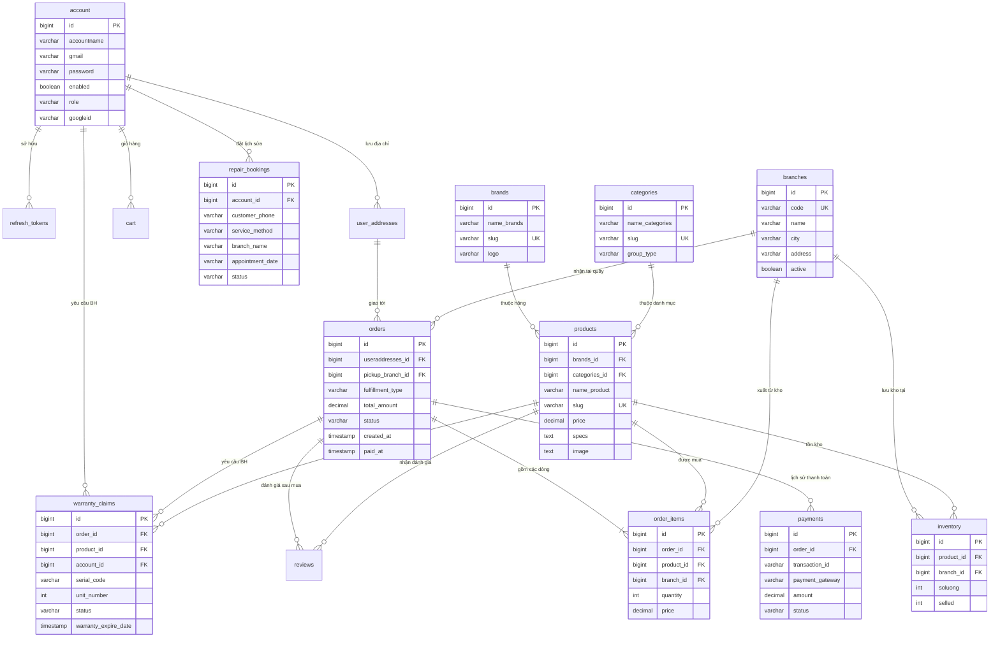

# 02. Thiết Kế Cơ Sở Dữ Liệu (PostgreSQL & Flyway `V1` → `V20`)

Hệ thống sử dụng **PostgreSQL 16** kết hợp **Flyway Migration** tự động kiểm tra và nâng cấp lược đồ (`V1` → `V20`). Tổng cộng ứng dụng hiện ánh xạ và vận hành trên **15 bảng nghiệp vụ đang hoạt động** chia thành 4 phân hệ rõ ràng (bảng `vouchers` đã được gỡ tại `V20__focus_core_branches_and_drop_vouchers.sql`, còn bảng lịch sử `supports` từ `V12` được giữ yên trong DB để bảo toàn checksum lịch sử Flyway nhưng không còn ánh xạ Entity/API).

---

## 1. Sơ đồ Quan hệ Thực thể (ER Diagram)

---

## 2. Chi tiết 15 bảng nghiệp vụ đang hoạt động theo Phân hệ

### Phân hệ A — Tài khoản & Bảo mật (3 bảng)

| Bảng | Migration | Khóa chính / Ràng buộc | Mô tả các cột quan trọng |
| :--- | :---: | :--- | :--- |
| **`account`** | `V1`, `V14` | `id` (PK) | `accountname`, `gmail`, `password` (BCrypt), `enabled` (`false` cho tới khi xác thực OTP), `role` (`USER` / `ADMIN`), `googleid` (OAuth2). |
| **`refresh_tokens`** | `V2` | `id` (PK), `token` (UNIQUE), FK `account_id` | Lưu Refresh Token dạng UUID, `expiry_date` (`TIMESTAMPTZ`), `revoked`. Có index `idx_refresh_tokens_account_id`. |
| **`user_addresses`** | `V6` | `id` (PK), FK `account_id` | Sổ địa chỉ nhận hàng cá nhân của khách (tối đa 5 địa chỉ/tài khoản): `username`, `phone` (10 số VN), `address`, `defaultaddress`. |

---

### Phân hệ B — Danh mục, Sản phẩm & Kho 3 Chi Nhánh Trọng Điểm (5 bảng)

| Bảng | Migration | Khóa chính / Ràng buộc | Mô tả các cột quan trọng |
| :--- | :---: | :--- | :--- |
| **`branches`** | `V18`, `V20` | `id` (PK), `code` (UNIQUE) | Hệ thống 3 chi nhánh trọng điểm đang hoạt động (`HN-THAIHA` Hà Nội, `HCM-QUAN10` TP.HCM, `DN-HAICHAU` Đà Nẵng): `name`, `city`, `district`, `address`, `phone`, `opening_hours`, `services`, `active`. |
| **`brands`** | `V3` | `id` (PK), `slug` (UNIQUE) | Thương hiệu sản phẩm (`Asus`, `Dell`, `Lenovo`, `Logitech`...): `name_brands`, `slug`, `logo`. |
| **`categories`** | `V4`, `V18` | `id` (PK), `slug` (UNIQUE) | Danh mục sản phẩm kèm phân nhóm `group_type` (`LAPTOP` \| `PC` \| `ACCESSORY`). |
| **`products`** | `V5`, `V18` | `id` (PK), `slug` (UNIQUE), FK `brands_id`, `categories_id` | Thông tin sản phẩm: `name_product`, `price` (`DECIMAL(18,2)`), `specs` (`TEXT`), `image` (`TEXT`), `description` (`TEXT`). |
| **`inventory`** | `V7`, `V18`, `V20` | `id` (PK), `UNIQUE(product_id, branch_id)`, FK `product_id`, `branch_id` | Tồn kho thực tế của **từng sản phẩm tại từng cơ sở**: `soluong` (tồn khả dụng), `selled` (đã bán). |

---

### Phân hệ C — Giỏ hàng, Đơn hàng & Thanh toán (4 bảng)

| Bảng | Migration | Khóa chính / Ràng buộc | Mô tả các cột quan trọng |
| :--- | :---: | :--- | :--- |
| **`cart`** | `V13` | `id` (PK), FK `product_id`, `account_id` | Lưu bền vững giỏ hàng trong PostgreSQL (`quality` = số lượng), đồng bộ song song với Redis Hash `cart:{accountId}`. |
| **`orders`** | `V8`, `V18`, `V19`, `V20` | `id` (PK), FK `useraddresses_id`, `pickup_branch_id` | Đơn hàng: `fulfillment_type` (`HOME_DELIVERY` \| `STORE_PICKUP`), `receiver_name`, `receiver_phone`, `total_amount`, `status` (`UNPAID` \| `COMPLETED` \| `CANCELLED`), `created_at`, `paid_at` (mốc bắt đầu bảo hành). |
| **`order_items`** | `V9`, `V18` | `id` (PK), FK `order_id`, `product_id`, `branch_id` | Chi tiết từng mặt hàng trong đơn, lưu cả `branch_id` (cơ sở xuất kho thực tế để hoàn kho chính xác nếu hủy đơn) và đơn giá `price` tại thời điểm mua. |
| **`payments`** | `V10` | `id` (PK), FK `order_id`, `CHECK (status IN ('PENDING','SUCCESS','FAILED'))` | Lịch sử giao dịch thanh toán: `transaction_id` (`SEPAY_{id}` hoặc mã GD VNPay), `payment_gateway` (`SEPAY` \| `VNPAY`), `amount`, `status`, `response_code`, `created_at`. |

---

### Phân hệ D — Hậu mãi, Bảo hành, Sửa chữa & Đánh giá (3 bảng)

| Bảng | Migration | Khóa chính / Ràng buộc | Mô tả các cột quan trọng |
| :--- | :---: | :--- | :--- |
| **`warranty_claims`** | `V15`, `V19` | `id` (PK), FK `order_id`, `product_id`, `account_id` | Yêu cầu bảo hành theo từng thiết bị: `serial_code` (`BH-{orderId}-{productId}-{unitNumber}`), `unit_number`, `issue_type`, `description`, `contact_phone`, `status`, `admin_note`, `warranty_months`, `warranty_expire_date`. Chỉ cho phép một yêu cầu đang xử lý trên mỗi thiết bị. |
| **`repair_bookings`** | `V16`, `V17`, `V19` | `id` (PK), FK `account_id` (nullable cho khách vãng lai) | Yêu cầu lịch sửa chữa kỹ thuật: `customer_name`, `customer_phone`, `service_method` (`AT_STORE` \| `AT_HOME`), `branch_name`, `home_address`, `device_model`, `service_type`, `issue_description`, `appointment_date`, `appointment_time`, `status`, `admin_note`. |
| **`reviews`** | `V11` | `id` (PK), FK `order_id`, `product_id`, `CHECK (rating BETWEEN 1 AND 5)` | Đánh giá sản phẩm sau khi mua (chỉ đơn `COMPLETED`/`PAID` mới được đánh giá, mỗi sản phẩm trong 1 đơn chỉ đánh giá 1 lần): `rating`, `comment`, `created_at`. |

---

## 3. Các Chỉ mục (Indexes) tối ưu hiệu năng truy vấn

Được bổ sung tại các migration tương ứng để tối ưu tốc độ lọc sản phẩm, tra cứu tồn kho đa chi nhánh, phân trang đơn hàng và tra cứu lịch sửa chữa:

- `idx_refresh_tokens_account_id` trên `refresh_tokens(account_id)`
- `idx_inventory_branch_id` trên `inventory(branch_id)` + Unique index `uk_inventory_product_branch(product_id, branch_id)`
- `idx_products_categories_id` trên `products(categories_id)`
- `idx_products_brands_id` trên `products(brands_id)`
- `idx_products_price` trên `products(price)`
- `idx_orders_status_created` trên `orders(status, created_at DESC)`
- `uk_warranty_active_claim_per_unit` trên `warranty_claims(order_id, product_id, unit_number)` cho các phiếu đang xử lý
- `idx_repair_bookings_schedule` trên `repair_bookings(appointment_date, appointment_time, status)`
