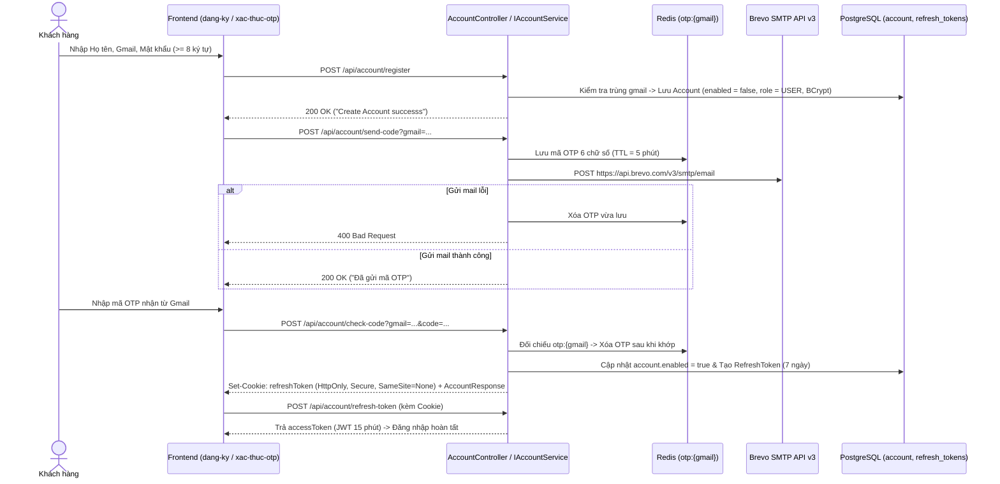
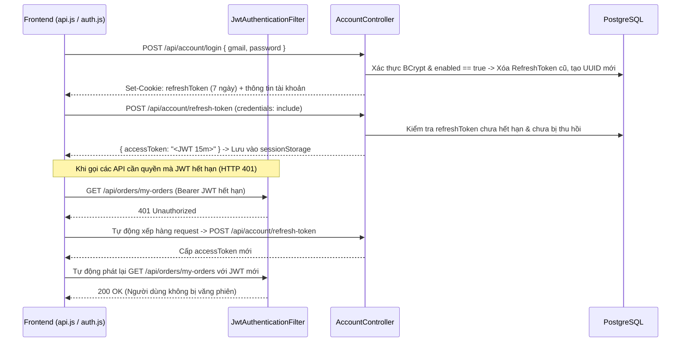

# Luồng 01 — Xác Thực Tài Khoản, OTP Redis/Brevo, JWT & Google OAuth2

Tài liệu này mô tả chi tiết luồng đăng ký, xác thực OTP qua email, đăng nhập phát hành cặp Token (JWT + HttpOnly Refresh Cookie), tự động làm mới phiên và đăng nhập bằng Google OAuth2.

---

## 1. Các thành phần tham gia trong Code

- **Controller:** `AUTH/controller/AccountController.java`, `AUTH/controller/UseradressController.java`
- **Security & Filter:** `AUTH/security/SecurityConfig.java`, `JwtAuthenticationFilter.java`, `JwtService.java`, `OAuth2SuccessHandler.java`, `CustomOAuth2UserService.java`
- **Service & Common:** `AccountService.java` / `AccountServiceImpl.java` (xử lý toàn bộ nghiệp vụ đăng nhập, phát hành/làm mới/thu hồi RefreshToken, kiểm tra Rate Limit OTP 60s), `EmailVerificationService.java` (gửi mail qua `common/BrevoEmailClient.java`), `RedisOtpServiceImpl.java`, `RedisRateLimiterService.java`, `RefreshTokenService.java`, `UseraddressServiceImpl.java`, `common/PhoneValidator.java`
- **Frontend:** `dang-ky.html`, `xac-thuc-otp.html`, `dang-nhap.html`, `assets/js/auth.js`, `assets/js/api.js`

---

## 2. Luồng Đăng ký & Kích hoạt OTP qua Redis + Brevo

---

## 3. Luồng Đăng nhập Thường, Làm mới JWT tự động & Đăng xuất

---

## 4. Luồng Đăng nhập Google OAuth2

1. Trình duyệt chuyển hướng tới `GET /oauth2/authorization/google`.
2. Sau khi người dùng xác thực với Google, `CustomOAuth2UserService` kiểm tra `gmail` trong bảng `account`:
   - Nếu chưa tồn tại: tự động khởi tạo tài khoản mới với `enabled = true`, `role = USER`, gắn `googleid`.
   - Nếu đã tồn tại: cập nhật `googleid` (nếu chưa có).
3. `OAuth2SuccessHandler` tạo `RefreshToken` (gắn vào cookie `HttpOnly`) và sinh `accessToken` JWT, sau đó redirect về `${app.frontend-url}/trangchu.html#accessToken=<JWT>`.
4. Đối với tài khoản tạo qua Google chưa có mật khẩu nội bộ (`password == null`), người dùng có thể đặt mật khẩu lần đầu qua `POST /api/account/set-gg-password` (kiểm tra bằng `GET /api/account/check-password`).

---

## 5. Bảo vệ Sổ địa chỉ nhận hàng (`Useraddresses`)

- Mỗi tài khoản được lưu tối đa **5 địa chỉ nhận hàng**.
- Trường `phone` bắt buộc đi qua `PhoneValidator.validateAndNormalize(...)` đảm bảo đúng **10 chữ số bắt đầu bằng `0`** (`^0\d{9}$`).
- Mọi thao tác cập nhật (`PUT /api/useraddresses/{id}/update`) và xóa (`DELETE /api/useraddresses/{id}/delete`) đều kiểm tra `findByIdAndAccountId(id, account.getId())` để chống truy cập chéo tài khoản (IDOR).
