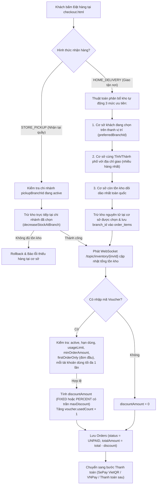
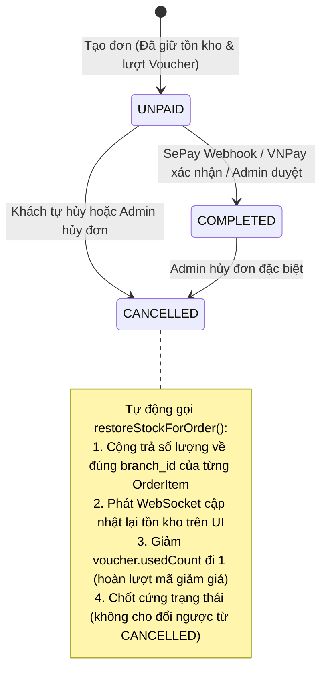

# Luồng 02 — Giỏ Hàng (DB + Redis), Voucher & Đặt Hàng Đa Cơ Sở

Tài liệu này mô tả luồng đồng bộ giỏ hàng hai tầng (PostgreSQL + Redis), kiểm tra mã giảm giá (Voucher), thuật toán phân bổ tồn kho đa chi nhánh khi đặt hàng và cơ chế hoàn kho tự động khi hủy đơn.

---

## 1. Các thành phần tham gia trong Code

- **Giỏ hàng:** `CartController.java`, `ICartService.java`, `IRedisCartService.java`, `CartRepository.java`
- **Khuyến mãi (Voucher):** `VoucherController.java`, `VoucherRepository.java`, `Voucher.java`
- **Tồn kho & Chi nhánh:** `BranchController.java`, `InventoryController.java`, `IInventoryService.java`, `InventoryWebSocketService.java`
- **Đơn hàng:** `OrderController.java`, `IOrdersService.java`, `OrdersRepository.java`
- **Frontend:** `cart.html`, `checkout.html`, `order.html`, `admin-inventory.html`, `admin-vouchers.html`, `admin-orders.html`

---

## 2. Cơ chế Giỏ hàng Hai tầng (Write-Through PostgreSQL + Redis Hash)

- **Cấu trúc trên Redis:** Mỗi khách hàng có một Redis Hash mang khóa `cart:{accountId}`, trong đó `field = productId` và `value = quantity`.
- **Ghi (`addCart`, `updateCart`, `deleteCart`):** Ghi bền vững vào bảng `cart` trong PostgreSQL trước (trong `@Transactional`), sau đó cập nhật đồng bộ ngay vào `cart:{accountId}` trên Redis.
- **Đọc (`showCart`):**
  1. Ưu tiên đọc nhanh danh sách `(productId, quantity)` từ Redis `cart:{accountId}`, kết hợp 1 câu truy vấn `JOIN FETCH` duy nhất từ `cartRepository.findByAccountId(...)` để lấy đầy đủ thông tin sản phẩm mà **không bị lỗi N+1 query**.
  2. Nếu Redis trống (ví dụ sau khi flush cache), tự động đọc từ PostgreSQL và nạp ngược lại (warm-up) vào Redis.

---

## 3. Luồng Đặt hàng Đa cơ sở & Áp dụng Voucher (`POST /api/orders/create`)

---

## 4. Vòng đời Trạng thái Đơn hàng & Cơ chế Hoàn kho Tự động

---

## 5. Nghiệp vụ Quản trị Kho Đa Cơ Sở dành cho Admin

Trong `IInventoryService.java` và `admin-inventory.html`, Admin có 4 công cụ điều phối hàng hóa trên toàn hệ thống chi nhánh:
1. **Khởi tạo / Nhập kho hàng loạt (`POST /api/inventory/create`):** Nhập hàng vào 1 cơ sở cụ thể hoặc bật cờ `allBranches = true` để phân bổ đồng loạt cho tất cả cơ sở đang hoạt động.
2. **Nhập thêm hàng (`PUT /api/inventory/{id}/soluong`):** Cộng dồn lượng hàng mới về kho chi nhánh.
3. **Kiểm kê điều chỉnh (`PUT /api/inventory/{id}/adjust`):** Chốt lại con số tồn kho thực tế sau kiểm kê kho vật lý.
4. **Điều chuyển nội bộ giữa các chi nhánh (`POST /api/inventory/transfer`):** Trừ tồn tại `fromBranchId` và cộng sang `toBranchId` trong cùng một giao dịch `@Transactional`, đảm bảo tổng tồn toàn chuỗi nhất quán.
