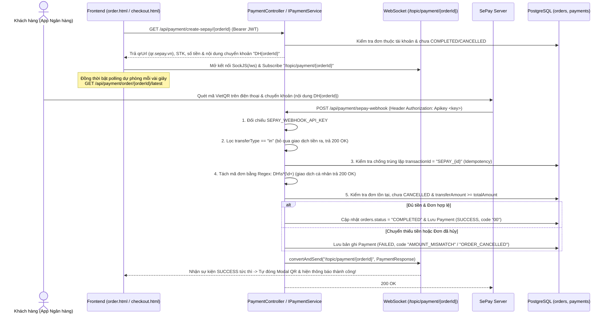
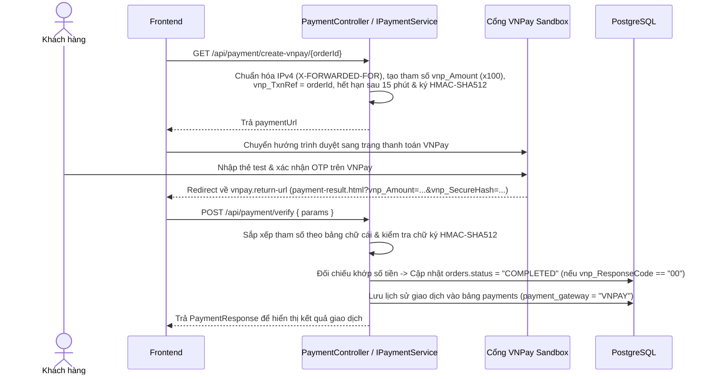

# Luồng 03 — Thanh Toán Trực Tuyến (SePay VietQR + WebSocket & VNPay)

Tài liệu này mô tả chi tiết hai luồng thanh toán điện tử tích hợp trong hệ thống: **Chuyển khoản ngân hàng tự động qua SePay (VietQR + Webhook + WebSocket Real-time)** và **Cổng thanh toán VNPay (HMAC-SHA512)**.

---

## 1. Các thành phần tham gia trong Code

- **Cấu hình:** `ORDER/config/SePayConfig.java`, `ORDER/config/VNPayConfig.java`, `PRODUCT/config/WebSocketConfig.java`
- **Controller:** `ORDER/controller/PaymentController.java`
- **Service & DTO:** `ORDER/service/impl/IPaymentService.java`, `SePayPaymentInfoResponse.java`, `SePayWebhookRequest.java`, `VerifyPaymentRequest.java`
- **Frontend:** `checkout.html`, `order.html` (hiển thị modal QR + kết nối SockJS/STOMP + cơ chế polling dự phòng), `payment-result.html`, `admin-payment.html`

---

## 2. Luồng Thanh toán VietQR Tự động qua SePay

### Các chốt an toàn quan trọng trong `processSePayWebhook`:
1. **Xác thực nguồn gọi:** Kiểm tra header `Authorization: Apikey <SEPAY_WEBHOOK_API_KEY>` (nếu biến môi trường được cấu hình), chặn hoàn toàn webhook giả mạo từ bên ngoài.
2. **Idempotency (Chống cộng/duyệt trùng):** Mỗi giao dịch SePay được gắn mã duy nhất `SEPAY_{id}` và kiểm tra qua `paymentRepository.existsByTransactionId(txId)` trước khi xử lý.
3. **Không gây vòng lặp Retry cho giao dịch ngoài luồng:** Giao dịch tiền ra (`out`) hoặc chuyển khoản cá nhân không chứa tiền tố `DH{mã_đơn}` được ghi nhận log nhẹ và trả `HTTP 200 OK` thay vì ném lỗi `400`, giúp SePay không gửi lại nhiều lần.
4. **Bảo vệ đơn đã hủy (`CANCELLED`):** Nếu khách chuyển khoản muộn vào một đơn đã bị hủy (đã hoàn kho), hệ thống không tự động bật lại `COMPLETED` mà ghi nhận bản ghi `Payment` với mã `ORDER_CANCELLED` để Admin đối soát hoàn tiền.

---

## 3. Luồng Thanh toán qua Cổng VNPay Sandbox (`HMAC-SHA512`)

