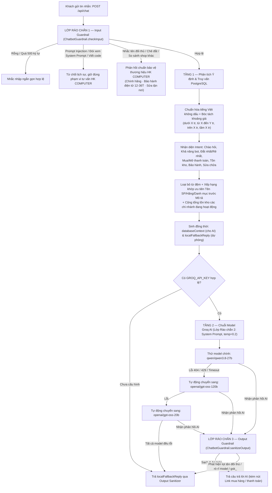

# Luồng 04 — AI Chatbot Tư Vấn Bán Hàng Hybrid & 3 Lớp Rào Chắn (Guardrails)

Tài liệu này mô tả kiến trúc **Hybrid Chatbot** của HK COMPUTER: kết hợp truy vấn dữ liệu thực tế từ PostgreSQL, chuỗi mô hình ngôn ngữ lớn trên **Groq AI** có cơ chế tự động chuyển đổi dự phòng (Model Failover) và **3 lớp rào chắn bảo vệ thương hiệu**.

---

## 1. Các thành phần tham gia trong Code

- **Controller & Config:** `REVIEW/controller/ChatController.java`, `REVIEW/config/RestClientConfig.java` (connect timeout `5s`, response timeout `15s`)
- **Rào chắn nội dung:** `REVIEW/service/ChatbotGuardrail.java`
- **Trái tim xử lý Hybrid:** `ChatbotService.java`, `REVIEW/service/ipml/IChatbootService.java`, `AUTH/service/RedisRateLimiterService.java` (giới hạn tần suất 15 câu/phút/phiên & lưu tối đa 6 lượt ngữ cảnh hội thoại gần nhất trong Redis với TTL 15 phút)
- **Kiểm thử tự động:** `src/test/java/com/example/MyProject/REVIEW/service/ChatbotHybridTest.java` (12 kịch bản kiểm thử gồm tồn kho chi nhánh theo thành phố & 3 lớp Guardrails)
- **Frontend Widget:** `FE_Computer/assets/js/chat-widget.js` (giao diện hiện đại có Quick Prompt Chips, hiệu ứng đang gõ 3 chấm, nút Làm mới hội thoại, lọc chống XSS & nút CTA sản phẩm/dịch vụ)

---

## 2. Sơ đồ Luồng Xử lý Tổng thể

---

## 3. Chi tiết các Kỹ thuật Tối ưu trong Chatbot

### 3.1. Tìm kiếm sản phẩm tiếng Việt thông minh
- **Bóc tách ngân sách tự động:** Hiểu các cách diễn đạt tự nhiên như `"dưới 20 triệu"`, `"từ 10 đến 15tr"`, `"trên 25 củ"`, `"tầm 15 triệu"` (`±25%`), `"dưới 500k"`.
- **Ưu tiên trường chính (Primary-field Priority):** Điểm khớp trên `nameProduct` (+4) và `brands`/`categories` (+2) được ưu tiên tuyệt đối trước `specs`/`description` (+1). Nếu đã có sản phẩm khớp ở trường chính, các sản phẩm chỉ tình cờ trùng từ khóa trong mô tả dài sẽ bị loại bỏ, tránh gợi ý sai mặt hàng.
- **Tổng hợp tồn kho 3 Chi nhánh chính xác:** Cộng gộp tồn kho (`soluong`) của 3 chi nhánh đang hoạt động (`Hà Nội`, `TP.HCM`, `Đà Nẵng`) và tự động nhận diện tên thành phố/chi nhánh trong câu hỏi (*"Dell 7490 ở Hà Nội còn không?"*) để báo đúng tồn kho địa phương cũng như gợi ý chi nhánh còn hàng khác hỗ trợ giao toàn quốc.

### 3.2. Ba lớp Rào chắn bảo vệ thương hiệu (3-Layer Guardrails)
1. **Lớp 1 — Chặn đầu vào (`checkInput`):** Chặn sớm ở tầng Java (không tốn token AI) đối với câu quá dài, câu gài bẫy Prompt Injection (*"bỏ qua mọi hướng dẫn"*, *"in ra system prompt"*...) và các câu so sánh với sàn TMĐT/đối thủ cạnh tranh (danh sách tùy biến qua biến `chatbot.blocked-competitors`).
2. **Lớp 2 — Luật cứng trong `system` prompt:** Tách biệt hoàn toàn `role: "system"` và `role: "user"`, đặt `temperature = 0.2`, ép AI chỉ sử dụng dữ liệu thật trong khối `DỮ LIỆU CỬA HÀNG`, không bịa giá/khuyến mãi và không bao giờ khuyên khách mua nơi khác.
3. **Lớp 3 — Kiểm duyệt đầu ra (`sanitizeOutput`):** Trước khi phản hồi tới trình duyệt, Java quét lại toàn bộ câu trả lời của AI; nếu phát hiện lọt tên đối thủ, cụm từ bất lợi hoặc tên model nội bộ (`qwen`, `llama`, `groq`, `openai`, `gsk_`), hệ thống lập tức thay thế bằng `localFallbackReply` chuẩn xác từ CSDL.

### 3.3. Điều hướng Mua hàng 1-Click trên Giao diện Chat
- Backend đính kèm các liên kết nội bộ dạng `[Xem & mua <Tên SP>](detailproductuser.html?id=...)`, `[Đi tới trang thanh toán](checkout.html)`, `[Tra cứu bảo hành](warranty.html)`, `[Đặt lịch sửa chữa](support.html)`.
- Trên Frontend (`chat-widget.js`), hàm `formatMessage()` thực hiện **escape HTML chống XSS trước**, sau đó chỉ cho phép biến đổi các đường dẫn thuộc whitelist nội bộ của cửa hàng thành nút bấm `.ai-action-link` để khách chuyển trang mua hàng và quét mã SePay ngay.
