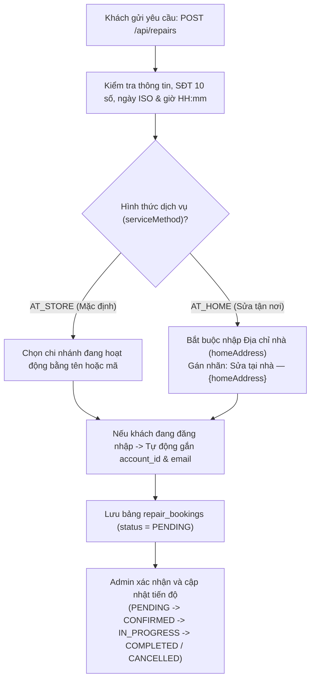

# Luồng 05 — Bảo Hành Điện Tử, Đặt Lịch Sửa Chữa & Đánh Giá Sản Phẩm

Tài liệu này mô tả các luồng dịch vụ kỹ thuật và chăm sóc sau bán hàng của **HK COMPUTER**: tra cứu thẻ bảo hành tính từ dữ liệu đơn hàng đã thanh toán, yêu cầu bảo hành, đặt lịch sửa chữa (tại cửa hàng hoặc tận nơi) và đánh giá sản phẩm xác thực mua hàng.

---

## 1. Các thành phần tham gia trong Code

- **Bảo hành điện tử:** `WarrantyController.java`, `REVIEW/service/impl/WarrantyServiceImpl.java` (sử dụng hợp đồng `OrdersService`), `WarrantyClaimRepository.java`, `WarrantyClaim.java`, `warranty.html` (hiển thị thanh tiến trình thời hạn bảo hành + timeline 4 bước), `admin-warranty.html` (bộ lọc trạng thái, tìm nhanh & mẫu ghi chú KTV)
- **Đặt lịch sửa chữa:** `RepairBookingController.java`, `REVIEW/service/impl/RepairBookingServiceImpl.java` (sử dụng hợp đồng `BranchService`), `RepairBookingRepository.java`, `RepairBooking.java`, `index.html#repair-center` (`home-repair.js` & `quick-repair-modal.js`), `profile.html` (timeline 4 bước theo dõi tiến độ sửa chữa), `admin-repairs.html` (bộ lọc hình thức `AT_STORE`/`AT_HOME`, trạng thái & mẫu ghi chú KTV)
- **Đánh giá sản phẩm:** `ReviewController.java`, `REVIEW/service/impl/ReviewServiceImpl.java` (sử dụng hợp đồng `OrdersService` & `ProductService`), `ReviewRepository.java`, `detailproductuser.html`, `order.html`, `review.html`

---

## 2. Luồng Bảo hành Điện tử Tự động (`Warranty`)

### 2.1. Thẻ bảo hành điện tử
Thẻ được tính từ các đơn ở trạng thái **`COMPLETED`/`PAID`** khi khách xem thẻ của mình hoặc tra cứu. Thẻ không được lưu riêng; bảng `warranty_claims` chỉ lưu các yêu cầu xử lý. Mốc bắt đầu là `orders.paid_at`, được ghi khi thanh toán thành công hoặc Admin xác nhận đơn đã thanh toán. Với dữ liệu cũ không có giao dịch thành công, migration dùng `created_at` làm mốc thay thế.
- **Mã Serial định danh từng thiết bị:** `BH-{orderId}-{productId}-{unitNumber}` (ví dụ: `BH-15-8-2`). `unitNumber` bắt đầu từ 1 và không vượt quá tổng số lượng sản phẩm đó trong đơn.
- **Thời hạn bảo hành tự động theo danh mục (`resolveWarrantyMonths`):**
  - Linh kiện lõi (`CPU`, `Main`, `VGA`, `RAM`): **36 tháng**.
  - Phụ kiện (`Chuột`, `Bàn phím`, `Phụ kiện`...): **12 tháng**.
  - Laptop, PC & các danh mục còn lại: **24 tháng**.
- **Tra cứu (`GET /api/warranty/lookup?keyword=...`):** Yêu cầu đăng nhập. Khách chỉ xem đơn của mình; Admin có thể tra cứu mọi đơn. Có thể nhập serial từng thiết bị, serial cũ `BH-{orderId}-{productId}` để xem các thiết bị cùng dòng hàng, hoặc mã đơn `DH15` / `15`.

### 2.2. Luồng Gửi & Xử lý Yêu cầu Bảo hành (`POST /api/warranty/claims`)

```mermaid
sequenceDiagram
    actor U as Khách hàng
    actor A as Kỹ thuật viên / Admin
    participant BE as WarrantyController / IWarrantyService
    participant DB as PostgreSQL (orders, warranty_claims)

    U->>BE: POST /api/warranty/claims { orderId, productId, unitNumber, issueType, description, contactPhone }
    BE->>BE: Kiểm tra SĐT 10 số (common.PhoneValidator)
    BE->>DB: 1. Kiểm tra đơn thuộc tài khoản & status == COMPLETED/PAID
    BE->>DB: 2. Kiểm tra sản phẩm, unitNumber nằm trong số lượng đã mua & chưa hết hạn
    BE->>DB: 3. Chặn phiếu đang xử lý trùng trên cùng thiết bị
    BE->>DB: Lưu WarrantyClaim (PENDING, serialCode = BH-{orderId}-{productId}-{unitNumber})
    BE-->>U: Trả thông tin phiếu yêu cầu bảo hành

    A->>BE: PATCH /api/warranty/admin/{id}/status?status=... { adminNote }
    BE->>DB: Chỉ cho phép chuyển trạng thái hợp lệ & ghi chú kỹ thuật
    Note over DB: PENDING -> RECEIVED -> REPAIRING -> COMPLETED; REJECTED từ các trạng thái đang xử lý
```

---

## 3. Luồng Đặt lịch Sửa chữa Kỹ thuật (`Repair Booking`)

Hỗ trợ **cả khách vãng lai (chưa đăng nhập)** lẫn **khách đã đăng nhập** gửi yêu cầu đặt lịch ngay tại khu vực `#repair-center` trên trang chủ:



Ngày hẹn phải là ngày hiện tại hoặc tương lai; giờ nhận `HH:mm` hoặc khoảng `HH:mm - HH:mm` và phải còn trong tương lai. Chi nhánh được đối chiếu với danh sách 3 chi nhánh đang hoạt động. Trạng thái chỉ chuyển theo thứ tự `PENDING -> CONFIRMED -> IN_PROGRESS -> COMPLETED`, có thể hủy trước khi hoàn tất.

---

## 4. Luồng Đánh giá Sản phẩm Đã mua (`Review`)

- **Đánh giá sản phẩm xác thực mua hàng (`POST /api/reviews`):**
  - Chỉ khách hàng **sở hữu đơn hàng** đó, đơn đã **`COMPLETED`/`PAID`**, sản phẩm thực sự nằm trong `order_items` của đơn và **chưa từng đánh giá** sản phẩm đó trong đơn (`existsByOrderIdAndProductId == false`) mới được phép gửi điểm sao (`1–5`) và nhận xét.
  - Đánh giá hiển thị công khai trên trang chi tiết sản phẩm (`GET /api/reviews/product/{productId}`).
